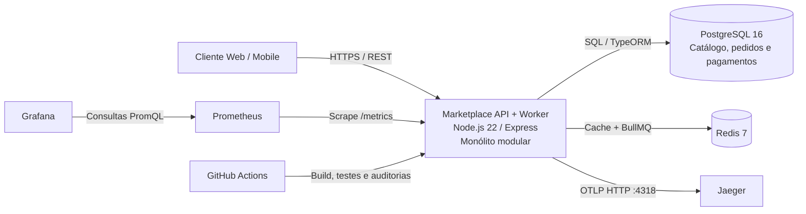

# C4 - Contêineres do Marketplace

## Diagrama de Contêineres (C4 Level 2)

## Responsabilidades e limites

- **Marketplace API + Worker**: uma aplicação Node.js que expõe a API REST e registra um worker BullMQ para processar pagamentos. A API aguarda o resultado do job para preservar o contrato HTTP atual. Catálogo, pedidos e pagamentos permanecem módulos internos, não serviços independentes.
- **PostgreSQL**: persistência transacional dos três módulos.
- **Redis**: cache-aside e broker da fila BullMQ.
- **Prometheus e Grafana**: coleta de `/metrics` e consulta/visualização das métricas RED.
- **Jaeger**: recebe traces pelo endpoint OTLP HTTP.
- **GitHub Actions**: valida código, dependências, contrato OpenAPI, build e testes antes da integração.

O diagrama de contexto C4 Level 1 está em [contexto.md](./contexto.md).
