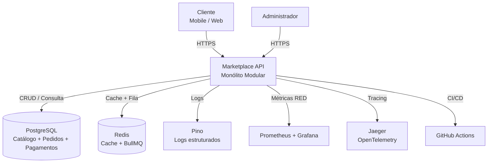

# C4 - Contexto do Marketplace

## Diagrama de Contexto (C4 Level 1)

## Descrição

O **Marketplace API** é um monólito modular que expõe endpoints REST para:
- **Catálogo**: produtos e categorias.
- **Pedidos**: criação e consulta de pedidos (reserva de estoque no catálogo).
- **Pagamento**: processamento via PIX, Cartão de Crédito e Boleto (Strategy Pattern).

Componentes externos:
- **PostgreSQL**: persistência transacional.
- **Redis**: cache tolerante a falhas e fila BullMQ (idempotente via `jobId`).
- **Prometheus/Grafana**: métricas RED (Rate, Errors, Duration).
- **Jaeger**: tracing distribuído via OpenTelemetry.
- **GitHub Actions**: pipeline de CI/CD.
